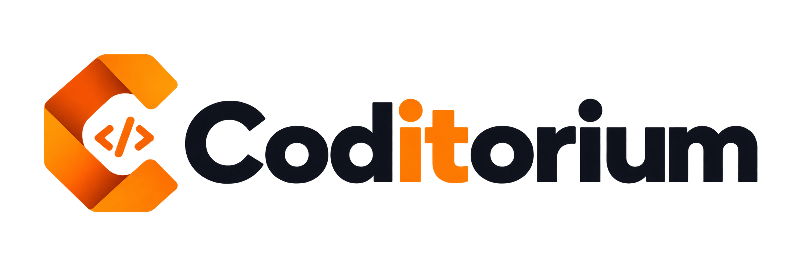
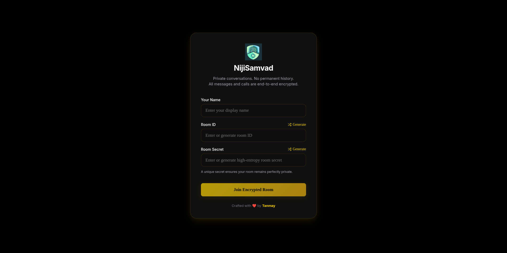
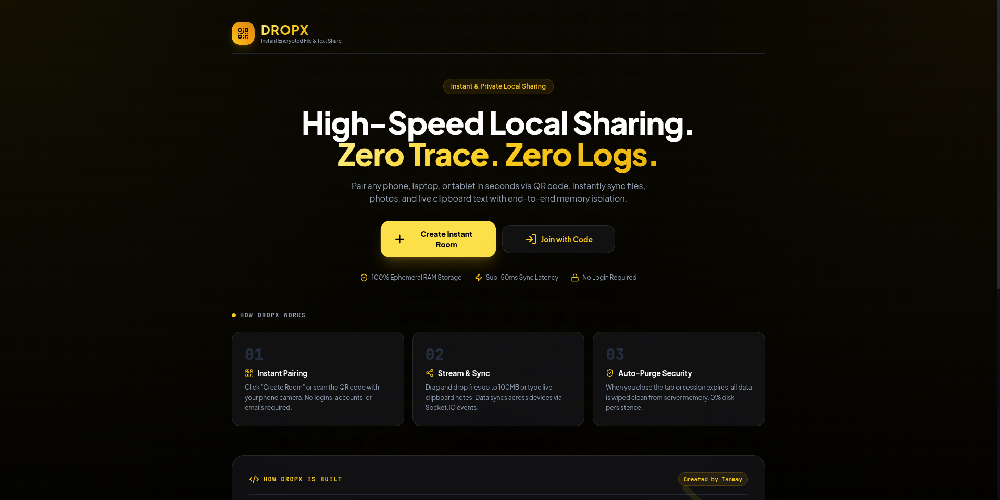
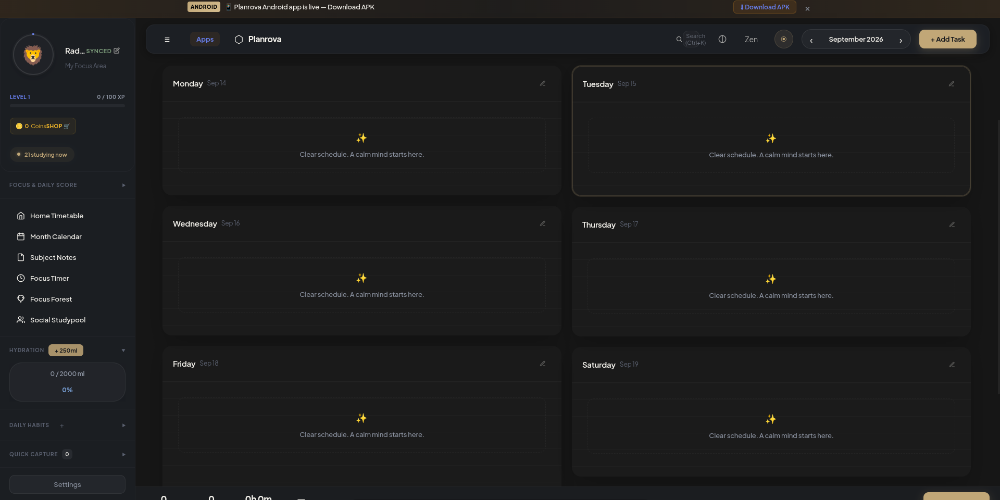
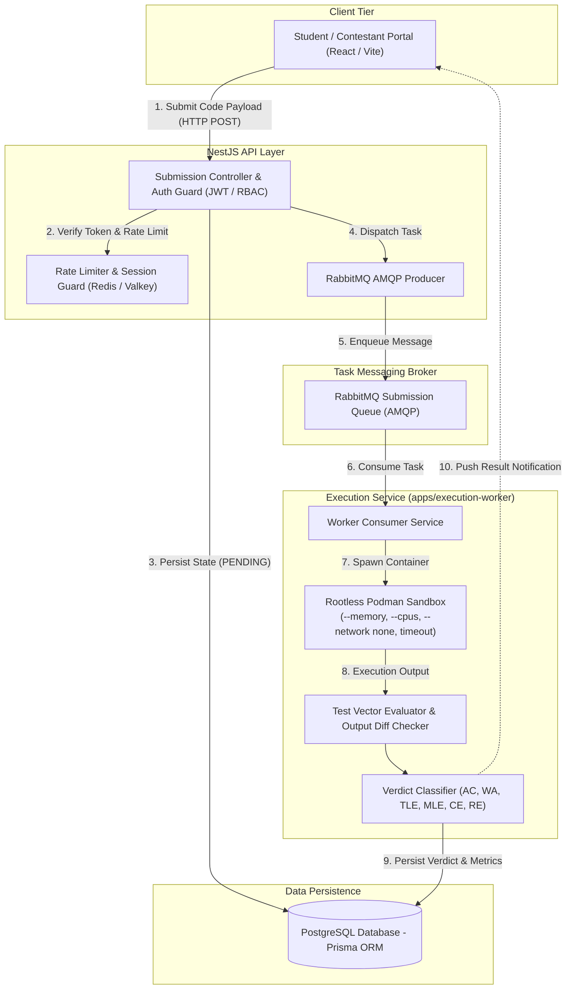

<div align="center">

# Tanmay Agrawal
**Full-Stack Developer | Backend Engineering | Distributed Systems & Cloud Infrastructure**

[](https://github.com/tanmay9783)

<p align="center">
  <a href="https://www.linkedin.com/in/tanmay041/" target="_blank">
    
  </a>
  &nbsp;
  <a href="https://github.com/tanmay9783">
    
  </a>
  &nbsp;
  <a href="mailto:tanmayagrawal0412@gmail.com">
    
  </a>
  &nbsp;
  <a href="https://github.com/tanmay9783/portfolio" target="_blank">
    
  </a>
</p>

</div>

---

### Executive Overview

I am a Computer Science Engineering undergraduate at **KIET Group of Institutions**, specializing in backend engineering, scalable application architecture, and cloud infrastructure.

- **Engineering Focus:** I design resilient full-stack systems with strong emphasis on decoupled service communication, asynchronous task queues, secure process isolation, and clean API design.
- **Architectural Mindset:** Practical experience implementing message brokering (RabbitMQ), sandboxed code execution (Rootless Podman), client-side cryptographic systems (WebCrypto API), and modular Infrastructure as Code (Terraform on AWS).
- **Core Standard:** Prioritizing code maintainability, least-privilege security boundaries, and defensive system design over premature optimization or unsupported claims.

---

### Technical Competencies

#### Technologies Used in Projects
Technologies verified and implemented across my active repositories and projects:

<table>
  <tr>
    <td width="22%"><strong>Languages</strong></td>
    <td>
      <a href="https://skillicons.dev"></a>
      <br/>
      <sub>TypeScript, JavaScript (ES6+), Java, Python, SQL, C, C++</sub>
    </td>
  </tr>
  <tr>
    <td width="22%"><strong>Backend & Real-Time</strong></td>
    <td>
      <a href="https://skillicons.dev"></a>
      <br/>
      <sub>Node.js, Express.js, NestJS, REST APIs, Socket.IO, WebRTC</sub>
    </td>
  </tr>
  <tr>
    <td width="22%"><strong>Databases & Messaging</strong></td>
    <td>
      <a href="https://skillicons.dev"></a>
      <br/>
      <sub>PostgreSQL, MongoDB, SQLite (better-sqlite3), Redis / Valkey, RabbitMQ (AMQP), Prisma ORM</sub>
    </td>
  </tr>
  <tr>
    <td width="22%"><strong>Cloud & Infrastructure</strong></td>
    <td>
      <a href="https://skillicons.dev"></a>
      <br/>
      <sub>AWS (EC2, S3, IAM), Docker, Rootless Podman, Terraform (IaC Workspaces), Linux Systems, Git, GitHub Actions</sub>
    </td>
  </tr>
  <tr>
    <td width="22%"><strong>Frontend & Mobile</strong></td>
    <td>
      <a href="https://skillicons.dev"></a>
      <br/>
      <sub>React 18/19, Next.js, React Native (Expo), Tailwind CSS, Vite, Three.js</sub>
    </td>
  </tr>
</table>

#### Currently Deepening & Exploring
Technologies actively being studied and tested in lab environments:
- **Container Orchestration:** Kubernetes (declarative pod lifecycle, ingress controllers, service mesh).
- **Advanced Distributed Systems:** Distributed consensus (Raft), database horizontal sharding, and event-driven microservices.
- **Advanced Data Structures & Algorithms:** Graph algorithms, dynamic programming, and amortized complexity.

---

### Featured Project Overview

<div align="center">
  <table>
    <tr>
      <td align="center" width="25%">
        <a href="#1-coditorium--competitive-coding--assessment-platform-flagship-project">
          
        </a>
        <br/>
        <strong>Coditorium</strong>
        <br/>
        <sub>Judge & Assessment Engine</sub>
      </td>
      <td align="center" width="25%">
        <a href="#2-nijisamvad--client-side-encrypted-communication--webrtc-mesh">
          
        </a>
        <br/>
        <strong>NijiSamvad</strong>
        <br/>
        <sub>Client-Side Encrypted Chat</sub>
      </td>
      <td align="center" width="25%">
        <a href="#3-dropx--temporary-cross-device-file-sharing-platform">
          
        </a>
        <br/>
        <strong>DropX</strong>
        <br/>
        <sub>Temporary File Sharing</sub>
      </td>
      <td align="center" width="25%">
        <a href="#4-planrova--local-first-academic-productivity-system">
          
        </a>
        <br/>
        <strong>Planrova</strong>
        <br/>
        <sub>Local-First Academic System</sub>
      </td>
    </tr>
  </table>
</div>

---

### Featured Engineering Projects

#### 1. [Coditorium — Competitive Coding & Assessment Platform](https://github.com/tanmay9783/Coditorium) *(Flagship Project)*
*Automated multi-language code grading and assessment engine featuring asynchronous job queues and isolated execution sandboxes.*

- **Problem Addressed:** Academic coding platforms face severe stability risks when evaluating arbitrary student code submissions. Running untrusted code on shared application hosts risks fork bombs, resource exhaustion, and privilege escalation, while synchronous execution causes severe API bottlenecks during high-traffic contests.
- **What I Implemented:** Architected the end-to-end judge submission pipeline. Built a NestJS API that ingests code submissions, persists pending state in PostgreSQL via Prisma, and dispatches evaluation jobs to RabbitMQ. Implemented a dedicated execution worker service that dequeues tasks and runs compilation and evaluation inside rootless Podman containers.
- **Architecture & System Design:**
  - **Monorepo Structure:** Structured via Turborepo containing `apps/backend` (NestJS REST API), `apps/frontend` (React + Vite), `apps/execution-worker` (isolated runner), and `packages/shared` (domain contracts).
  - **Asynchronous Task Queue:** Submission ingestion is fully decoupled from execution using RabbitMQ AMQP channels. Queue reliability is enforced via durable queue declarations (`{ durable: true }`), disk-persisted message delivery (`{ persistent: true }`), and explicit worker acknowledgments (`{ noAck: false }`) to mitigate message loss during unexpected worker or network interruptions.
  - **Security Jail (Rootless Podman):** Untrusted code executes inside rootless Podman containers with dropped capabilities, isolated namespaces, explicit CPU quotas (`--cpus`), strict memory bounds (`--memory`), disabled network access (`--network none`), and execution timeouts to mitigate denial-of-service and host privilege escalation risks.
- **Key Technical Decisions:**
  - Selected **RabbitMQ** over in-memory or simple Redis task queues to implement durable queue declarations, disk-persisted messages, and explicit consumer acknowledgment (`ack`/`nack`) semantics to prevent message loss during worker crashes.
  - Chose **Rootless Podman** over standard rootful Docker daemons to substantially reduce the host attack surface by executing untrusted containers without root privileges, mitigating root privilege escalation vectors on the host system.
- **Current Limitations:** Per-submission container initialization introduces container cold-start latency compared to long-running worker processes; maintaining warm container pools or exploring microVM virtualization (e.g., Firecracker) are identified future milestones.
- **Tech Stack:** `NestJS`, `React`, `Vite`, `TypeScript`, `PostgreSQL`, `Prisma ORM`, `RabbitMQ`, `Redis/Valkey`, `Rootless Podman`
- **Repository:** [github.com/tanmay9783/Coditorium](https://github.com/tanmay9783/Coditorium)

---

#### 2. [NijiSamvad — Client-Side Encrypted Communication & WebRTC Mesh](https://github.com/tanmay9783/NijiSamvad)
*Ephemeral, zero-database real-time messaging and peer-to-peer WebRTC audio/video communication platform.*

- **Problem Addressed:** Centralized collaboration applications persist user messages, identifiers, and media metadata indefinitely in cloud databases, leaving sensitive communication exposed to database leaks and server-side compromise.
- **What I Implemented:** Engineered an ephemeral communication platform combining client-side cryptographic key derivation, stateless WebSocket signaling, and direct peer-to-peer WebRTC audio/video mesh calling.
- **Architecture & System Design:**
  - **Zero Server Persistence:** The Node.js signaling server operates strictly in volatile RAM, holding active socket rooms in memory with zero relational or document database retention.
  - **Client-Side Cryptographic Pipeline:** Browser clients derive symmetric 256-bit AES-GCM keys locally from high-entropy room secrets using the Web Crypto API (`crypto.subtle`) via PBKDF2 (SHA-256, 100,000 iterations).
  - **Opaque Signal Relaying:** Chat messages and file payloads are encrypted client-side with AES-256-GCM using unique 12-byte initialization vectors (IVs) and transited over Socket.IO as opaque ciphertext buffers without server decryption access.
  - **WebRTC Peer Mesh:** Audio and video streams route directly between client browsers using DTLS-SRTP encryption, using the signaling server strictly for SDP offer/answer exchange and ICE candidates.
- **Key Technical Decisions:**
  - Utilized standard browser-native **Web Crypto API** primitives rather than external cryptographic npm packages to reduce bundle overhead and rely directly on W3C standard web platform implementations.
  - Implemented visual SHA-256 fingerprint verification (formatted as human-readable numerical blocks) to allow participants to detect man-in-the-middle tampering out-of-band.
- **Current Limitations:** Relies on a pre-shared room secret between participants; does not implement an asymmetric Double Ratchet protocol (e.g., Signal Protocol) and therefore does not provide Perfect Forward Secrecy (PFS).
- **Tech Stack:** `React 19`, `Node.js 18+`, `Socket.IO 4.8`, `Web Crypto API (AES-256-GCM)`, `WebRTC`, `Tailwind CSS`
- **Repository:** [github.com/tanmay9783/NijiSamvad](https://github.com/tanmay9783/NijiSamvad)

---

#### 3. [DropX — Temporary Cross-Device File Sharing Platform](https://github.com/tanmay9783/dropx)
*Temporary cross-device file and text sharing utility featuring ambiguity-free room discovery and automated TTL memory cleanups.*

- **Problem Addressed:** Transferring files and clipboard text between heterogeneous devices (iOS, Android, Windows, macOS, Linux) typically forces users through account registrations, cloud drive uploads, or email attachments, leaving permanent data trails on third-party servers.
- **What I Implemented:** Developed an ephemeral cross-device data bridge enabling quick device pairing via QR codes or 6-character room codes, supporting temporary file uploads and clipboard synchronization with automated session eviction.
- **Architecture & System Design:**
  - **Discovery & Pairing Engine:** Generates Crockford-style Base32 room codes that explicitly omit ambiguous visual characters (`0`, `O`, `1`, `I`, `L`) to eliminate cross-device typing errors.
  - **Upload Pipeline:** Upload routes receive binary payloads via `express.raw()` capped at 100MB, writing temporary files to local disk storage while indexing metadata in SQLite/file repositories.
  - **Automated Lifecycle Eviction:** Room sessions are bounded by a configurable TTL (default 120 minutes); automated periodic background cleanups purge active WebSocket rooms and delete associated disk files upon session expiry.
- **Key Technical Decisions:**
  - Integrated Redis state synchronization to coordinate room membership, active participant presence, and rate limits across server processes.
  - Applied client-side AES-256-GCM encryption before transport to secure payloads during transit.
- **Current Limitations:** Upload handler buffers payload chunks in memory via `express.raw()` rather than streaming multi-part chunks directly through backpressure-controlled streams, capping maximum single-file upload size to 100MB.
- **Tech Stack:** `Node.js`, `Express.js`, `React`, `Vite`, `Tailwind CSS`, `Redis`, `Socket.IO`, `Web Crypto API`
- **Repository:** [github.com/tanmay9783/dropx](https://github.com/tanmay9783/dropx)

---

#### 4. [Planrova — Local-First Academic Productivity System](https://github.com/tanmay9783/planrova)
*Multi-platform academic management system combining lightweight local-first web runtimes with native Android alarm bridges.*

- **Problem Addressed:** Student academic productivity workflows suffer from tool fragmentation across disparate apps for schedules, timers, and notes. Furthermore, cloud-dependent planners become unusable in campus environments with intermittent connectivity.
- **What I Implemented:** Architected a local-first study ecosystem featuring a lightweight web dashboard, a companion React Native mobile application, a native Android Kotlin bridge for system alarms, and OCR ingestion of handwritten study notes.
- **Architecture & System Design:**
  - **Local-First Distributed State:** Engineered offline-first local storage patterns ensuring full timetable and habit management functionality without network dependencies.
  - **Android Native Alarm Bridge:** Implemented custom Kotlin modules (`AlarmManager`, `AlarmReceiver`) that interface with React Native to schedule exact system alarms using `setAlarmClock()` and Foreground Services, ensuring timers wake the device despite Android Doze mode.
  - **Zero-Virtual-DOM Web Runtime:** Built the desktop client in vanilla ES6 to ensure minimal memory overhead on resource-constrained hardware.
  - **Multimodal AI OCR Integration:** Connected an isolated proxy pipeline with Groq Vision API to digitize handwritten study notes and academic syllabi into structured task lists.
- **Key Technical Decisions:**
  - Built custom native Android Kotlin alarm bridges rather than relying on generic JavaScript timers, which are suppressed when the device enters deep sleep.
- **Current Limitations:** Exact alarms rely on Android OS permissions (`SCHEDULE_EXACT_ALARM`) and remain subject to aggressive OEM battery optimization overrides or manual application force-stops.
- **Tech Stack:** `React Native (Expo 54)`, `Android Native (Kotlin)`, `Vanilla ES6`, `Cloud Firestore`, `Groq Vision API`
- **Repository:** [github.com/tanmay9783/planrova](https://github.com/tanmay9783/planrova)

---

#### 5. [AI-Assisted Patient Intake (Sanjeevni AI)](https://github.com/tanmay9783/Sanjeevni-AI)
*AI-assisted patient intake kiosk featuring interactive 3D virtual avatars, speech recognition, and localized pain mapping.*

- **Problem Addressed:** High patient volumes in community health clinics lead to extended waiting periods and diagnostic bottlenecks, where healthcare workers spend substantial time gathering routine demographic and symptom histories from low-literacy patients.
- **What I Implemented:** Built the **Sanjeevni AI** patient intake kiosk—an interactive web application designed for clinic entry points, featuring a 3D animated assistant, speech recognition in Hindi/Hinglish/English, and an interactive 2D anatomical body pain map.
- **Architecture & System Design:**
  - **Kiosk Interface:** Built with React 18, Three.js, and Web Speech API to provide an accessible, hands-free conversational interface for low-literacy patients.
  - **Localized Pain Mapping:** Developed an interactive 2D anatomical body SVG map with 1–10 severity sliders, translating visual patient inputs into standardized anatomical coordinates.
  - **Local-First Edge Storage:** Implemented local SQLite (`better-sqlite3`) storage on the kiosk node to persist demographic inputs, form responses, and anatomical coordinate logs locally. While core form logging functions without network access, multimodal AI extraction requires connectivity to reach Groq/LLaMA endpoints.
  - **Separation of Concerns:** Built as an AI-assisted client-facing intake tier that structures patient dialogues into clinical SOAP summaries; designed to integrate asynchronously with **Swasya AI** (a separate companion clinical command center built for attending physicians).
- **Key Technical Decisions:**
  - Employed edge-deployed SQLite on the kiosk node to retain patient responses locally and mitigate data loss during connectivity dropouts.
- **Current Limitations:** Speech recognition accuracy remains dependent on ambient clinic acoustic noise; the system is designed solely for preliminary history-taking and triage pre-screening, not autonomous clinical diagnosis.
- **Tech Stack:** `React 18`, `Three.js`, `Node.js (Express)`, `FastAPI`, `SQLite (better-sqlite3)`, `Groq LLaMA 3.3`
- **Repository:** [github.com/tanmay9783/Sanjeevni-AI](https://github.com/tanmay9783/Sanjeevni-AI)

---

#### 6. [Terraform Multi-Environment AWS Infrastructure](https://github.com/tanmay9783/terraform-multi-environment)
*Modular Infrastructure as Code repository provisioning parameterized cloud environments across Dev and Prod.*

- **Problem Addressed:** Manual cloud provisioning produces configuration drift, inconsistent security policies, and deployment errors between development and production environments.
- **What I Implemented:** Developed modular Terraform configurations that provision EC2 instances, VPC associations, and security groups dynamically across isolated environments.
- **Architecture & System Design:** Utilizes Terraform Workspaces and environment-specific `.tfvars` files (`terraform.tfvars.dev`, `terraform.tfvars.prod`) to decouple configuration values from infrastructure definitions, querying AWS dynamic data sources (`aws_subnets`, `aws_ami`) to eliminate hardcoded identifiers.
- **Key Technical Decisions:** Decoupled environment state into dedicated workspace state partitions, substantially mitigating the risk of accidental state collisions or cross-environment resource overwrites during development and production runs.
- **Current Limitations:** Currently operates within default VPC subnets rather than provisioning custom multi-tier VPC topologies with private subnets, NAT gateways, and public load balancers.
- **Tech Stack:** `Terraform (HCL)`, `AWS (EC2, VPC, IAM)`, `Linux Shell`
- **Repository:** [github.com/tanmay9783/terraform-multi-environment](https://github.com/tanmay9783/terraform-multi-environment)

---

### Systems Architecture & Execution Lifecycle

#### Diagram 1: Coditorium Judge Execution Pipeline
The architectural flow below details the end-to-end decoupled lifecycle of an untrusted code submission in **Coditorium**:



> **Technical Flow:** Submissions are ingested via NestJS, validated against rate limits in Redis/Valkey, and persisted in PostgreSQL as `PENDING`. An AMQP message is published to RabbitMQ, decoupling the HTTP request cycle from execution. An independent execution worker consumes the message, spawns an isolated Rootless Podman container enforcing strict cgroups and network isolation, evaluates stdout/stderr against test vectors, and commits the final verdict.

---

#### Diagram 2: NijiSamvad Cryptographic Key Derivation & Ephemeral Signaling
The sequence below illustrates the client-side cryptographic key derivation and zero-database relay lifecycle implemented in **NijiSamvad**:

```mermaid
sequenceDiagram
    autonumber
    actor Alice as Peer A (Client Browser)
    participant Server as Ephemeral Signaling Server (Socket.IO)
    actor Bob as Peer B (Client Browser)

    Note over Alice,Bob: 1. Out-of-Band Room Secret Exchange
    Alice->>Alice: Derive AES-256-GCM Key & Auth Hash via PBKDF2 (SHA-256, 100k iter)
    Bob->>Bob: Derive AES-256-GCM Key & Auth Hash via PBKDF2 (SHA-256, 100k iter)

    Note over Alice,Bob: 2. Ephemeral Room Connection (Zero Server Persistence)
    Alice->>Server: join-room (roomName, authHash)
    Bob->>Server: join-room (roomName, authHash)
    Server-->>Alice: user-joined (Bob)

    Note over Alice,Bob: 3. WebRTC Peer Mesh Signaling (DTLS-SRTP)
    Alice->>Server: sdp-offer (relayed as opaque JSON)
    Server->>Bob: sdp-offer
    Bob->>Server: sdp-answer (relayed as opaque JSON)
    Server->>Alice: sdp-answer
    Alice->>Bob: Direct P2P Audio / Video Stream (Media Mesh)

    Note over Alice,Bob: 4. Encrypted Text & File Transport
    Alice->>Alice: Encrypt message payload with AES-256-GCM (Random 12-byte IV)
    Alice->>Server: send-message {iv, ciphertext}
    Server->>Bob: receive-message {iv, ciphertext}
    Note over Server: Server acts as blind relay in volatile RAM; zero database retention
    Bob->>Bob: Decrypt payload using local in-memory AES Key
```

> **Technical Flow:** Peer clients independently derive identical 256-bit AES-GCM encryption keys and room authentication hashes from a shared secret using browser-native Web Crypto PBKDF2. The Socket.IO server acts purely as an ephemeral signaling conduit in volatile memory, relaying SDP payloads for direct WebRTC peer connections and passing encrypted message blobs without possessing decryption capabilities or database storage.

---

### Core Engineering Principles

- **Modularity & Decoupled Responsibilities:** Architecting systems with strict boundaries between transport controllers, domain business logic, and persistence layers. Business workflows remain decoupled from specific database engines or communication protocols.
- **Defense in Depth & Least Privilege:** Enforcing input sanitization and schema validation at all ingestion boundaries, running execution runtimes as non-root users with stripped Linux capabilities, and isolating sensitive secrets away from persistent application storage.
- **Storage Strategy & Data Integrity:** Designing database schemas with foreign key referential integrity, indexing frequent query paths, using transactions for state mutations requiring atomicity, and employing distributed caches (Redis) strictly for read-heavy cache eviction patterns.
- **Predictable API Contracts:** Adhering to predictable RESTful standards, consistent JSON error serialization formats, explicit HTTP status codes, and backward-compatible contract design.
- **Fault Tolerance & Resource Discipline:** Designing worker pipelines that gracefully handle consumer disconnections, socket dropped frames, and external API timeouts without crashing host processes. Using bounded buffers and streams to prevent excessive memory consumption.

---

### 🧮 Competitive Programming & Problem Solving

<div align="center">
  <p align="center">
    <a href="https://leetcode.com/u/tanmay041/" target="_blank">
      
    </a>
    &nbsp;
    <a href="https://codeforces.com/profile/tanmay0412" target="_blank">
      
    </a>
    &nbsp;
    <a href="https://www.codechef.com/users/tanmay041" target="_blank">
      
    </a>
    &nbsp;
    <a href="https://www.hackerrank.com/tanmay041" target="_blank">
      
    </a>
  </p>

  <p align="center">
    
    &nbsp;&nbsp;
    
  </p>
</div>

---

### Certifications & Milestones

<table>
  <tr>
    <td width="50%">
      <h4>☁️ AWS Certified Cloud Practitioner</h4>
      <p>Validated core AWS cloud infrastructure, IAM security, VPC networking, and Well-Architected Framework principles. [<a href="https://cp.certmetrics.com/amazon/en/public/verify/credential/fac9701f985443a3a5cad85982cc6520" target="_blank">Verify Credential</a>]</p>
    </td>
    <td width="50%">
      <h4>🤖 AWS Certified AI Practitioner</h4>
      <p>Validated foundational knowledge of machine learning architectures, cloud AI services, security controls, and responsible AI governance. [<a href="https://cp.certmetrics.com/amazon/en/public/verify/credential/4ad652a9eeee41e39af0dfabae4fcc8a" target="_blank">Verify Credential</a>]</p>
    </td>
  </tr>
  <tr>
    <td width="50%">
      <h4>📜 AWS Academy Graduate — Generative AI Foundations</h4>
      <p>Practical grounding in large language model pipelines, prompt engineering architectures, and cloud-hosted LLM services. [<a href="https://www.credly.com/earner/earned/badge/ff32dd8b-470b-4dd4-b7da-536382d97959" target="_blank">Verify Credly Badge</a>]</p>
    </td>
    <td width="50%">
      <h4>🏆 NIT Jalandhar Hackathon — Top 10 Finalist</h4>
      <p>Ranked in the Top 10 out of 100+ teams for architecting and presenting real-time distributed software during a competitive 36-hour sprint.</p>
    </td>
  </tr>
</table>

---

### GitHub Analytics & Contribution Activity

<div align="center">

  
  &nbsp;
  

</div>

<div align="center" style="margin-top: 15px;">
  
</div>

<div align="center" style="margin-top: 25px;">
  <h4>Contribution Grid Activity</h4>
  <picture>
    <source media="(prefers-color-scheme: dark)" srcset="https://raw.githubusercontent.com/tanmay9783/tanmay9783/output/github-contribution-grid-snake-dark.svg">
    <source media="(prefers-color-scheme: light)" srcset="https://raw.githubusercontent.com/tanmay9783/tanmay9783/output/github-contribution-grid-snake.svg">
    
  </picture>
  <br/>
  <sub><em>Automated daily contribution snake generated via GitHub Actions.</em></sub>
</div>

---

<div align="center">
  <p>
    <em>"Focused on clean architecture, resilient data pipelines, and defensible engineering choices."</em>
  </p>
  <p>
    <strong>Tanmay Agrawal</strong> &bull; <a href="https://www.linkedin.com/in/tanmay041/">LinkedIn</a> &bull; <a href="https://github.com/tanmay9783">GitHub</a> &bull; <a href="mailto:tanmayagrawal0412@gmail.com">tanmayagrawal0412@gmail.com</a>
  </p>
</div>
