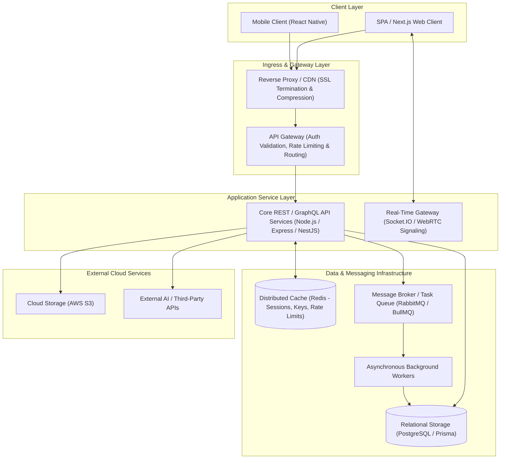

<div align="center">

# Tanmay Agrawal
**Full-Stack Developer | Backend Engineering | Distributed Systems & Cloud Architecture**

[](https://github.com/tanmay9783)

<p align="center">
  <a href="https://www.linkedin.com/in/tanmay041/" target="_blank">
    
  </a>
  &nbsp;
  <a href="https://github.com/tanmay9783">
    
  </a>
  &nbsp;
  <a href="mailto:tanmayagrawal0412@gmail.com">
    
  </a>
  &nbsp;
  <a href="https://leetcode.com/u/tanmay041/" target="_blank">
    
  </a>
  &nbsp;
  <a href="https://codeforces.com/profile/tanmay0412" target="_blank">
    
  </a>
</p>

</div>

---

### Executive Overview

I am a Computer Science Engineering undergraduate at **KIET Group of Institutions**, focused on designing end-to-end web applications, robust backend architectures, and distributed systems. 

- **Engineering Scope:** I build reliable full-stack applications with an emphasis on API design, asynchronous processing, memory-efficient data pipelines, and real-time state synchronization.
- **Architectural Mindset:** Passionate about low-latency system design, cryptographic privacy (zero-knowledge and end-to-end encryption), and isolated execution runtimes.
- **Infrastructure & Cloud:** Hands-on experience containerizing services with Docker, writing declarative multi-environment infrastructure with Terraform on AWS, and exploring Kubernetes cluster management.
- **Current Objective:** Seeking high-impact software engineering internships and collaborative opportunities where I can contribute to production-grade backend and full-stack systems.

---

### Technical Competencies

The following technologies represent tools and frameworks implemented across my production repositories and active engineering projects:

<table>
  <tr>
    <td width="24%"><strong>Languages</strong></td>
    <td>
      <a href="https://skillicons.dev"></a>
      <br/>
      <sub>TypeScript, JavaScript (ES6+), Java, Python, SQL</sub>
    </td>
  </tr>
  <tr>
    <td width="24%"><strong>Backend & Real-Time</strong></td>
    <td>
      <a href="https://skillicons.dev"></a>
      <br/>
      <sub>Node.js, Express.js, NestJS, RESTful APIs, Socket.IO, WebRTC, Asynchronous Event Loops</sub>
    </td>
  </tr>
  <tr>
    <td width="24%"><strong>Databases & Messaging</strong></td>
    <td>
      <a href="https://skillicons.dev"></a>
      <br/>
      <sub>PostgreSQL, MongoDB Atlas, SQLite (better-sqlite3), Redis (Caching & Distributed Locking), RabbitMQ, Prisma ORM, Firebase</sub>
    </td>
  </tr>
  <tr>
    <td width="24%"><strong>Cloud & Infrastructure</strong></td>
    <td>
      <a href="https://skillicons.dev"></a>
      <br/>
      <sub>AWS (EC2, S3, IAM, CloudWatch), Docker, Kubernetes, Terraform (IaC Modules), Linux Shell / Systems</sub>
    </td>
  </tr>
  <tr>
    <td width="24%"><strong>Frontend Engineering</strong></td>
    <td>
      <a href="https://skillicons.dev"></a>
      <br/>
      <sub>React 18/19, Next.js, React Native (Expo), Tailwind CSS, Vite, Three.js, State Management</sub>
    </td>
  </tr>
  <tr>
    <td width="24%"><strong>Tooling & Versioning</strong></td>
    <td>
      <a href="https://skillicons.dev"></a>
      <br/>
      <sub>Git, GitHub Actions (CI/CD Pipelines), WebCrypto API, npm/pnpm/yarn</sub>
    </td>
  </tr>
</table>

---

### Featured Engineering Projects

#### 1. [Coditorium — Online Judge & Assessment Platform](https://github.com/tanmay9783/Coditorium)
*Competitive programming, contest hosting, and automated code grading engine with isolated evaluation sandboxes.*

- **Problem Statement:** Educational institutions and contest organizers require automated, cheat-resistant evaluation of multi-language student code submissions with low-latency scoring and strict hardware resource limits.
- **Architecture & Implementation:**
  - Designed an asynchronous submission pipeline that queues and decouples code submissions from client HTTP request lifecycles.
  - Implemented an isolated container sandbox jail enforcing CPU time limits, memory boundaries, and standard I/O redirection to prevent arbitrary host exploitation and denial-of-service loops.
  - Multi-language compilation and execution runner supporting C++, Java, Python, and JavaScript against hidden test vectors.
  - Role-based access control (RBAC) separating administrative contest management and test case authoring from student candidate views.
  - Real-time leaderboard state synchronized over WebSocket connections during active timed assessments.
- **Tech Stack:** `React`, `Node.js`, `Express.js`, `Docker (Sandbox)`, `Redis`, `PostgreSQL`, `Prisma ORM`, `Socket.IO`
- **Source Code:** [github.com/tanmay9783/Coditorium](https://github.com/tanmay9783/Coditorium)

```
[Student Submission] ➔ [API Gateway / Auth] ➔ [Redis Task Queue] ➔ [Sandbox Worker (Docker Jail)] ➔ [Test Diff & Verdict] ➔ [DB + WS Broadcast]
```

---

#### 2. [NijiSamvad — Zero-Knowledge E2EE Real-Time Messaging & WebRTC Mesh](https://github.com/tanmay9783/NijiSamvad)
*Zero-database, cryptographically sovereign communication platform engineered with client-side AES-256-GCM encryption.*

- **Problem Statement:** Mainstream collaboration platforms retain metadata, conversation transcripts, and file attachments in cloud-hosted databases, creating persistent vectors for data breach and credential exploitation.
- **Architecture & Implementation:**
  - **Zero Server Persistence:** Engineered an ephemeral signaling server operating in volatile memory with absolute zero relational or document database persistence.
  - **Client-Side Cryptography:** Utilized browser-native WebCrypto API to execute client-side key derivation via PBKDF2 (SHA-256, 100,000 iterations) and symmetric authenticated encryption via AES-256-GCM.
  - **Opaque Signal Relaying:** Ciphertext payloads transit the Node.js/Socket.IO gateway as opaque binary/string buffers without the server possessing keys or decryption ability.
  - **WebRTC Multimedia Mesh:** Integrated direct peer-to-peer audio and video calling over DTLS-SRTP, using the signaling server strictly for ICE candidate and SDP offer/answer exchange.
- **Tech Stack:** `React 19`, `Node.js 18+`, `Socket.IO 4.8`, `WebCrypto API (AES-256-GCM)`, `WebRTC`, `Tailwind CSS`
- **Source Code:** [github.com/tanmay9783/NijiSamvad](https://github.com/tanmay9783/NijiSamvad)

---

#### 3. [DropX — Ephemeral Cross-Device Data & Clipboard Streaming Platform](https://github.com/tanmay9783/dropx)
*High-speed local/remote file streaming and clipboard synchronization system with automated TTL memory cleanup.*

- **Problem Statement:** Moving files and clipboard text across heterogeneous operating systems (iOS, Android, Windows, macOS, Linux) typically forces users into account sign-ups, email attachments, or permanent cloud drive clutter.
- **Architecture & Implementation:**
  - **Memory-Bounded Streaming Pipeline:** Implemented Node.js chunked stream handlers (`busboy`) piping multipart binary files directly to disk/network without holding complete multi-gigabyte payloads in heap memory.
  - **Zero-Friction Discovery:** Built dynamic QR code generation and Crockford-style ambiguity-free 6-character room code identifiers (omitting I, L, O, 0, 1) for rapid pairing.
  - **Distributed State & TTL Eviction:** Managed ephemeral session state and concurrent device connections using Redis locks; automated background cron tasks and TTL monitors ensure complete wiping of file data and active channels upon session termination.
  - **Zero-Knowledge Encryption:** Encrypted payloads client-side with AES-256-GCM before transport.
- **Tech Stack:** `Node.js`, `Express.js`, `React`, `Vite`, `Tailwind CSS`, `Redis`, `Socket.IO`, `Web Crypto API`
- **Source Code:** [github.com/tanmay9783/dropx](https://github.com/tanmay9783/dropx)

---

#### 4. [Planrova — Local-First Academic Productivity & Study Ecosystem](https://github.com/tanmay9783/planrova)
*Multi-platform academic management system combining lightweight local-first web runtimes with native Android alarm bridges.*

- **Problem Statement:** Students face tool fragmentation across separate apps for timetables, Pomodoro sessions, and notes, while cloud-dependent tools drop inputs during high-latency or disconnected campus network conditions.
- **Architecture & Implementation:**
  - **Local-First Distributed Architecture:** Designed offline-first local storage and synchronization patterns that retain full responsiveness without blocking the UI thread during network dropouts.
  - **Android Native Kotlin Bridges:** Integrated native `AlarmManager` and Foreground Services to build tamper-proof focus and study session alarms capable of bypassing aggressive OEM battery killers.
  - **Zero-Virtual-DOM Core:** Architected the web dashboard in vanilla ES6 to minimize memory footprint and execution overhead on low-spec campus hardware.
  - **Multimodal AI Vision Integration:** Connected an isolated proxy pipeline with Groq Vision OCR to digitize handwritten academic schedules, notes, and study goals into structured digital records.
- **Tech Stack:** `React Native (Expo 54)`, `Android Native (Kotlin)`, `Vanilla ES6`, `Cloud Firestore`, `Groq Vision API`
- **Source Code:** [github.com/tanmay9783/planrova](https://github.com/tanmay9783/planrova)

---

#### 5. [Sanjeevni AI & Swasya AI — Autonomous Primary Healthcare Intake & Triage System](https://github.com/tanmay9783/Sanjeevni-AI)
*Edge-deployed 3D conversational intake kiosk synchronized with a clinical hospital command center.*

- **Problem Statement:** Primary Healthcare Centres (PHCs) in developing regions face patient-to-doctor ratios exceeding 1:11,000, forcing medical officers to spend 70% of consultation time on repetitive manual intake documentation.
- **Architecture & Implementation:**
  - **Multimodal Conversational Intake:** Engineered a hands-free multilingual voice dialogue interface (Web Speech API) combined with an interactive Three.js 3D doctor avatar to assist low-literacy patients.
  - **Interactive Anatomical Pain Mapping:** Developed a 3D anatomical model interface enabling patients to visually demarcate pain coordinates and intensity before physical consultation.
  - **Clinical Decision Support & SOAP Handoff:** Structured voice dialogues into formatted clinical SOAP (Subjective, Objective, Assessment, Plan) records and risk-stratified triage summaries via LLaMA models.
  - **Dual-Tier Edge/Cloud Storage:** Deployed lightweight SQLite (`better-sqlite3`) on local kiosk nodes for zero-latency edge intake, asynchronously synchronizing clinical records with a centralized MongoDB Atlas command center.
- **Tech Stack:** `React 18`, `Three.js`, `Node.js (Express 5)`, `FastAPI`, `Groq LLaMA 3.3`, `SQLite`, `MongoDB Atlas`
- **Source Code:** [github.com/tanmay9783/Sanjeevni-AI](https://github.com/tanmay9783/Sanjeevni-AI)

---

### Systems Architecture & Engineering Thinking

#### Diagram 1: Production Multi-Tier Web & Asynchronous Processing Architecture
The architectural workflow below represents how I structure scalable, decoupled web applications from user ingress to state persistence and background execution:



#### Diagram 2: Coditorium Sandboxed Online Judge Execution Pipeline
The lifecycle below illustrates the concrete execution flow implemented for untrusted user code compilation and automated evaluation in **Coditorium**:

```mermaid
flowchart LR
    subgraph UserInterface["Client Experience"]
        UI["Code Editor & Contest View (React)"]
    end

    subgraph Ingestion["API & Queue Ingestion"]
        API["Express API Server"]
        AUTH["JWT Session & RBAC Verification"]
        QUEUE["Redis / BullMQ Submission Queue"]
    end

    subgraph ExecutionCore["Isolated Sandboxed Judge Engine"]
        DISPATCH["Worker Job Dispatcher"]
        JAIL["Isolated Container Sandbox (Strict cgroups / RAM / CPU limits)"]
        RUNNER["Multi-Language Compiler & Runner (C++, Java, Python, JS)"]
        EVAL["Test Vector Evaluator & Output Diff Checker"]
        VERDICT["Verdict Classifier (AC, WA, TLE, MLE, CE)"]
    end

    subgraph PersistenceAndEvents["Persistence & Broadcast"]
        DB[("PostgreSQL Database (Submissions & Problem Bank)")]
        EVENT["Socket.IO Event Broadcaster"]
        BOARD["Live Contest Leaderboard"]
    end

    UI -->|"Submit Code Payload"| API
    API --> AUTH
    AUTH -->|"Enqueue Job"| QUEUE
    QUEUE -->|"Dispatch Task"| DISPATCH
    DISPATCH -->|"Spin Up Container"| JAIL
    JAIL --> RUNNER
    RUNNER --> EVAL
    EVAL --> VERDICT
    VERDICT -->|"Persist Verdict & Stats"| DB
    VERDICT -->|"Emit Result Event"| EVENT
    EVENT -->|"Stream Results"| UI
    EVENT -->|"Live Rank Update"| BOARD
```



---

### Core Engineering Principles

In developing software, I adhere to the following principles to ensure stability, maintainability, and security:

- **Modularity & Separation of Concerns:** Designing software with decoupled controllers, business logic services, and data access layers. Business logic remains independent of transport protocols and database engines.
- **Defense in Depth & Zero-Knowledge Architecture:** Validating and sanitizing inputs at application boundaries (Zod/Joi schema validation), enforcing principle of least privilege in cloud IAM policies, and adopting zero-knowledge client-side encryption when handling sensitive user communication.
- **Storage Strategy & Database Integrity:** Modeling schemas with strict referential constraints, indexing frequent query paths, using transactions for state mutations that require atomicity, and layering Redis for read-heavy cache eviction patterns.
- **Strict API Contracts:** Adhering to predictable RESTful conventions, consistent JSON error serialization schemas, and backward-compatible versioning.
- **Graceful Failure & Resilience:** Constructing fault-tolerant background pipelines where worker failures, socket disconnects, or third-party API outages fail safely without terminating host processes.
- **Resource Discipline:** Avoiding memory bloat by processing large payloads via streams and bounded buffers rather than loading whole entities into heap memory.

---

### Certifications & Milestones

<table>
  <tr>
    <td width="50%">
      <h4>☁️ AWS Certified AI Practitioner</h4>
      <p>Demonstrated foundational understanding of artificial intelligence, machine learning concepts, and AWS cloud AI/ML infrastructure and security services.</p>
    </td>
    <td width="50%">
      <h4>🏆 Top 10 Finalist — National Hackathon (NIT Jalandhar)</h4>
      <p>Recognized among top nationwide teams for prototyping and presenting a high-throughput, innovative software solution evaluated by industry judges.</p>
    </td>
  </tr>
  <tr>
    <td width="50%">
      <h4>📜 AWS Academy Graduate — Generative AI Foundations</h4>
      <p>Comprehensive training on foundation models, prompt engineering, fine-tuning methodologies, and responsible AI system architecture.</p>
    </td>
    <td width="50%">
      <h4>🏗️ Modular Infrastructure as Code (Terraform)</h4>
      <p>Authored fully parameterized, multi-environment AWS infrastructure modules with clean variable separation and zero hardcoded configuration state.</p>
    </td>
  </tr>
</table>

---

### GitHub Analytics & Activity

<div align="center">

  
  &nbsp;
  

</div>

<div align="center" style="margin-top: 15px;">
  
</div>

<div align="center" style="margin-top: 25px;">
  <h4>Contribution Grid Activity</h4>
  <picture>
    <source media="(prefers-color-scheme: dark)" srcset="https://raw.githubusercontent.com/tanmay9783/tanmay9783/output/github-contribution-grid-snake-dark.svg">
    <source media="(prefers-color-scheme: light)" srcset="https://raw.githubusercontent.com/tanmay9783/tanmay9783/output/github-contribution-grid-snake.svg">
    
  </picture>
  <br/>
  <sub><em>Automated daily contribution snake generated via GitHub Actions.</em></sub>
</div>

---

### 🧮 Competitive Programming & Problem Solving

<div align="center">
  <p align="center">
    <a href="https://leetcode.com/u/tanmay041/" target="_blank">
      
    </a>
    &nbsp;
    <a href="https://codeforces.com/profile/tanmay0412" target="_blank">
      
    </a>
    &nbsp;
    <a href="https://www.codechef.com/users/tanmay041" target="_blank">
      
    </a>
    &nbsp;
    <a href="https://www.hackerrank.com/tanmay041" target="_blank">
      
    </a>
  </p>

  <p align="center">
    
    &nbsp;&nbsp;
    
  </p>
</div>

---

### Currently Investigating & Exploring

- **Advanced Data Structures & Algorithms:** Deepening graph traversal paradigms, dynamic programming, and amortized complexity analysis.
- **Distributed Systems Architecture:** Studying consensus protocols, event-driven architectures with message brokers, and horizontal data partitioning (sharding).
- **Cloud Infrastructure & Kubernetes:** Practicing declarative container orchestration, pod autoscaling, ingress controllers, and automated CI/CD deployment pipelines on AWS.

---

### Professional Collaboration & Contact

I am open to technical discussions, open-source collaboration, and software engineering opportunities.

<p align="center">
  <a href="https://www.linkedin.com/in/tanmay041/" target="_blank">
    
  </a>
  &nbsp;&nbsp;
  <a href="mailto:tanmayagrawal0412@gmail.com">
    
  </a>
  &nbsp;&nbsp;
  <a href="https://github.com/tanmay9783">
    
  </a>
</p>

<p align="center">
  <em>"Engineered with a focus on clean architecture, resilient data pipelines, and scalable software systems."</em>
</p>
